# Hybrid Machine Learning, Quantum QUBO Optimization and Parallel Computing for University Exam Scheduling
**Project report with methodology, results and analysis**

### Optimization Techniques Lab
**OT Lab Exam, Question 4 (5 marks)**

---

### Table 1. Submission details
| Field | Details |
| :--- | :--- |
| **Student** | Siyam Bubere |
| **Registration ID** | 241070012 |
| **Class** | TY B.Tech Computer Engineering, Semester 5 |
| **Course / Lab** | Optimization Techniques Lab (OT Lab Exam, Q4) |
| **Random seed** | 012 (Python integer 12) |
| **Course outcomes** | CO1 (Machine Learning), CO2 (QUBO / Quantum), CO4 (Parallel Computing) |
| **Source repository** | github.com/siyam-bubere/OT-LABEXAM-Q4 |

---

## Table of Contents
1. [Abstract and Summary of Results](#1-abstract-and-summary-of-results)
2. [Introduction and Problem Statement](#2-introduction-and-problem-statement)
   - 2.1 [Question 4 as set](#21-question-4-as-set)
   - 2.2 [Overall approach](#22-overall-approach)
3. [Assumptions](#3-assumptions)
   - 3.1 [The four target exams](#31-the-four-target-exams)
4. [Tools and Repository Structure](#4-tools-and-repository-structure)
5. [Part (a): Machine Learning with Support Vector Regression](#5-part-a-machine-learning-with-support-vector-regression)
   - 5.1 [Features and target](#51-features-and-target)
   - 5.2 [Synthetic data (seed = 012)](#52-synthetic-data-seed--012)
   - 5.3 [Model](#53-model)
   - 5.4 [Predictions for the four exams](#54-predictions-for-the-four-exams)
6. [Part (b): QUBO Formulation and Brute-Force Verification](#6-part-b-qubo-formulation-and-brute-force-verification)
   - 6.1 [Decision variables](#61-decision-variables)
   - 6.2 [Energy function](#62-energy-function)
   - 6.3 [Building Q](#63-building-q)
   - 6.4 [Brute-force check over all 256 states](#64-brute-force-check-over-all-256-states)
7. [Part (c): Quantum Annealing on a Simulator](#7-part-c-quantum-annealing-on-a-simulator)
   - 7.1 [Method](#71-method)
   - 7.2 [Results (1000 reads, seed 12)](#72-results-1000-reads-seed-12)
   - 7.3 [Comparison with brute force](#73-comparison-with-brute-force)
8. [Part (d): Parallel Computing with multiprocessing.Pool](#8-part-d-parallel-computing-with-multiprocessingpool)
9. [Part (e): Conclusion in Three Lines](#9-part-e-conclusion-in-three-lines)
10. [Verification and Testing](#10-verification-and-testing)
11. [Discussion and Limitations](#11-discussion-and-limitations)
12. [Conclusion](#12-conclusion)
13. [References and Reproduction](#references-and-reproduction)

---

## 1. Abstract and Summary of Results
An examination cell must place four exams into two time slots so that students enrolled in two exams are not forced to sit them together. Pairwise clash counts are not known in advance and must be estimated from enrolment features. This report documents a four-stage pipeline that solves the problem: (a) a Support Vector Regression (SVR) model predicts the number of common students between exam pairs; (b) the scheduling decision is written as a Quadratic Unconstrained Binary Optimization (QUBO) problem over eight binary variables and verified by exhaustive search of all 256 states; (c) the QUBO is solved with simulated annealing as a stand-in for quantum annealing; and (d) independent annealing restarts are distributed over 1, 2 and 4 CPU workers with `multiprocessing.Pool` to measure speed-up and efficiency.

The pipeline recovers the global optimum: Slot 1 holds Exam 2 and Exam 4, Slot 2 holds Exam 1 and Exam 3, with a predicted total clash of 9.77 students. Exams 1 and 2 are the highest-risk pair (39.70 predicted common students), and the optimal schedule separates them.

### Table 2. Executive summary of results
| Component | Result | CO |
| :--- | :--- | :---: |
| **Dataset** | 600 synthetic rows, seed 12, split 420 train / 180 test | CO1 |
| **SVR (RBF, C = 50, epsilon = 1)** | Test RMSE = 3.4376 students, Test $R^2 = 0.9326$ | CO1 |
| **QUBO size** | 8 binary variables, 256 states, 16 valid, lambda = 100 | CO2 |
| **Brute-force ground state** | $E = 9.77$ at `01100110` and `10011001` (symmetric twins) | CO2 |
| **Simulated annealing** | 1000 reads $\times$ 300 sweeps; best $E = 9.77$; found in 148 / 1000 reads (14.8%) | CO2 |
| **Parallel scaling (16 restarts)** | $T_1 = 19.89\text{ s}$, $T_2 = 14.28\text{ s}$ ($1.39\times$), $T_4 = 13.59\text{ s}$ ($1.46\times$) | CO4 |
| **Efficiency** | 100.0% (1), 69.6% (2), 36.6% (4 workers) | CO4 |

---

## 2. Introduction and Problem Statement
Timetabling for university examinations is a classic NP-hard combinatorial problem. In practice, enrolment rosters are partial or unavailable until late in the term, so the clash matrix (how many students are registered for both exam $i$ and exam $j$) cannot be read directly. However, department, year of study, elective status and class size correlate strongly with overlap, so a regression model can estimate the clash counts. Once estimated, the allocation becomes an optimization problem that fits the input format of quantum annealers such as D-Wave, and of classical simulators of them.

### 2.1 Question 4 as set
An exam cell must place 4 exams into 2 time slots. Students enrolled in two exams cannot sit them together, but clash counts are available only from enrolment features. An SVR predicts the number of common students from department, year, elective flag and class size. A quantum algorithm then assigns each exam to one of two options (8 yes/no choices), and parallel computing speeds up repeated runs.

### Table 3. Sub-parts of Question 4
| Part | Task | Marks / CO |
| :---: | :--- | :---: |
| **a** | Create about 600 synthetic rows (seed 012), split 70/30, train SVR, report RMSE and $R^2$, show predictions for the 4 exams | 1.0 / CO1 |
| **b** | Write the QUBO, build Q from the predictions, add a rule-breaking penalty, verify the lowest-energy answer by brute force | 1.0 / CO2 |
| **c** | Solve with simulated quantum annealing; report best answer, energy and frequency; compare with brute force | 1.5 / CO2 |
| **d** | Run independent restarts in parallel with `multiprocessing.Pool`; report time for 1, 2, 4 workers, speed-up and efficiency | 1.0 / CO4 |
| **e** | Three-line conclusion: final choice and what was learned | 0.5 / CO4 |

### 2.2 Overall approach
The workflow connects five modular stages:
1. **(a) ML:** 600 rows, seed 12, 70/30 split, SVR (RBF).
2. **Clash matrix $C$:** $4 \times 4$ symmetric predicted overlaps.
3. **(b) QUBO:** 8 binary vars, $Q$ ($8 \times 8$) + penalty, brute force 256.
4. **(c) Annealing:** 1000 reads, 300 sweeps, compared vs brute force.
5. **(d) Parallel:** `mp.Pool` with 1, 2, 4 workers measuring $S_p$ and $E_p$.
6. **(e) Conclusion:** Slot 1 = {Exam 2, Exam 4}, Slot 2 = {Exam 1, Exam 3}, $E = 9.77$.

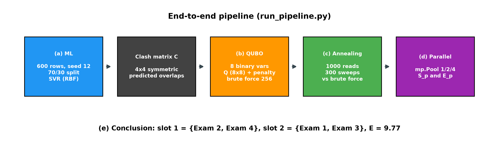
*Figure 1. End-to-end pipeline implemented in run_pipeline.py, stages (a) to (e).*

---

## 3. Assumptions
- **Discrete grid.** Four exams $i \in \{1, \dots, 4\}$ and two non-overlapping slots $s \in \{1, 2\}$. Each exam must occupy exactly one slot.
- **Binary state space.** $x(i, s) = 1$ if exam $i$ is in slot $s$. This gives $4 \times 2 = 8$ variables, $2^8 = 256$ states, of which $2^4 = 16$ satisfy the single-slot rule.
- **Symmetric clashes.** $C(i, j) = C(j, i)$ and $C(i, i) = 0$.
- **Seed.** The question gives `seed = 012`; as a Python decimal integer this is `12`, used for data generation, the 70/30 split and the annealer.
- **Penalty weight.** $\lambda = 100$ exceeds the largest possible valid clash cost (the sum of all six predicted pair clashes is about 71.7), so every rule-violating state costs more than any valid schedule.
- **Enrolment dynamics for the synthetic data.** Same department and same year with both core courses overlap 65–85% of the smaller class; same department and year with an elective, 35–55%; same department but different year, 5–15%; different department with a shared year and an elective, 5–20%; everything else, 0–4%. Gaussian noise ($\sigma = 1.5$) is added and counts are clipped to $[0, \min \text{class size}]$.

### 3.1 The four target exams
### Table 4. Profiles of the exams to be scheduled
| Exam | Code | Dept | Year | Type | Class size |
| :--- | :--- | :---: | :---: | :---: | :---: |
| **Exam 1** | CS301 | CS | 3 | Core | 120 |
| **Exam 2** | CS305 | CS | 3 | Elective | 80 |
| **Exam 3** | EE302 | EE | 3 | Core | 100 |
| **Exam 4** | CS401 | CS | 4 | Core | 90 |

---

## 4. Tools and Repository Structure
### Table 5. Technology stack
| Category | Tool | Purpose |
| :--- | :--- | :--- |
| **Language** | Python 3.9+ | Implementation (tested up to 3.13) |
| **Numerics** | NumPy, SciPy | Vectorised QUBO algebra, random sampling |
| **Machine learning** | scikit-learn | SVR (RBF kernel), StandardScaler, Pipeline, train/test split, metrics |
| **Data handling** | pandas | Synthetic dataset as a DataFrame |
| **Plotting** | matplotlib | Result figures |
| **Parallelism** | multiprocessing (stdlib) | Pool-based independent annealing restarts |
| **Testing** | unittest (stdlib) | 11 automated tests across modules |

```text
OT-LABEXAM-Q4/
 run_pipeline.py         # runs stages a -> e, writes plots and metrics_summary.json
 src/config.py           # seed, exam profiles, lambda, annealing and parallel settings
 src/ml_svr.py           # Part a: data generation, SVR, clash prediction
 src/qubo_builder.py     # Part b: Q matrix, decoder, brute-force solver
 src/quantum_solver.py   # Part c: simulated (quantum) annealing, comparison
 src/parallel_runner.py  # Part d: multiprocessing.Pool restarts, S_p and E_p
 src/conclusion.py       # Part e: three-line conclusion
 src/visualizer.py       # figures
 tests/                  # unit tests for each module
 notebooks/              # exam_scheduling_q4.ipynb
 results/                # PNG figures and metrics_summary.json
```

---

## 5. Part (a): Machine Learning with Support Vector Regression

### 5.1 Features and target
Each row describes a pair of courses $(A, B)$. The feature vector has five entries: `same_dept` ($1$ if the departments match), `same_year` ($1$ if the years match), `elective_flag` ($0, 1 \text{ or } 2$ electives in the pair), and the two class sizes. The target is `common_students`, the number of students enrolled in both courses.
$$\mathbf{x}(A,B) = \left[ \mathbb{I}_{(\text{dept}_A = \text{dept}_B)}, \; \mathbb{I}_{(\text{year}_A = \text{year}_B)}, \; \text{elec}_A + \text{elec}_B, \; N_A, \; N_B \right]^T$$

### 5.2 Synthetic data (seed = 012)
600 rows were generated with `numpy.random.default_rng(12)` following the overlap regimes in Section 3. Figure 2 shows the target distribution and the mean clash for each regime; as intended, pairs from the same department and year dominate the large clashes.

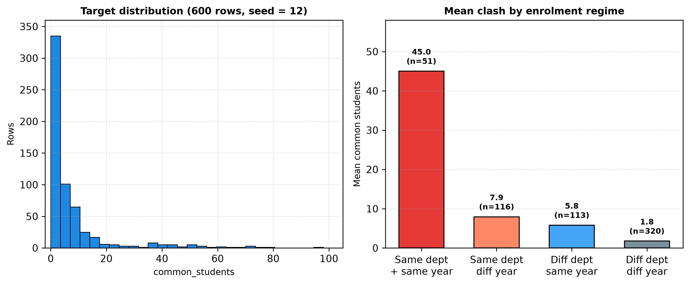
*Figure 2. Distribution of the synthetic target and mean clash by enrolment regime.*

### 5.3 Model
The data were split 70/30 (420 training, 180 test rows) with `random_state = 12`. Features were standardised and an RBF-kernel SVR ($C = 50, \epsilon = 1.0$) was fitted. SVR solves the following problem, where the RBF kernel $K(\mathbf{x}, \mathbf{x}') = \exp(-\gamma \|\mathbf{x} - \mathbf{x}'\|^2)$ induces the feature map:
$$\min_{\mathbf{w}, b, \boldsymbol{\xi}, \boldsymbol{\xi}^*} \frac{1}{2} \|\mathbf{w}\|^2 + C \sum_k (\xi_k + \xi_k^*) \quad \text{s.t.} \quad |y_k - (\mathbf{w} \cdot \phi(\mathbf{x}_k) + b)| \le \epsilon + \xi_k$$
$$\text{RMSE} = \sqrt{\frac{1}{N} \sum_k (y_k - \hat{y}_k)^2}, \qquad R^2 = 1 - \frac{\sum_k (y_k - \hat{y}_k)^2}{\sum_k (y_k - \bar{y})^2}$$

### Table 6. SVR performance
| Metric | Training (420) | Test (180) |
| :--- | :---: | :---: |
| **RMSE (students)** | 2.2593 | 3.4376 |
| **$R^2$** | 0.9695 | 0.9326 |

The test $R^2$ of 0.93 means the model explains about 93% of the variance in clash counts on unseen rows. The gap between training and test error is small, so there is no sign of serious overfitting. The scatter plot in Figure 3 shows predictions hugging the ideal line at small and medium counts; the single large-clash outlier (true value near 96) is under-predicted, which is typical of SVR with a finite epsilon-tube and few large-valued samples.

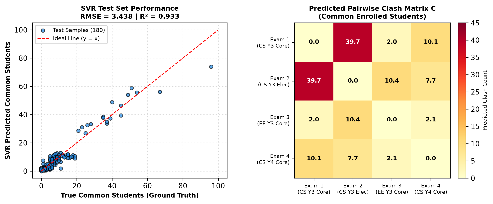
*Figure 3. Left: actual vs predicted common students on the 180 test rows. Right: predicted 4x4 clash matrix C.*

### 5.4 Predictions for the four exams
### Table 7. Predicted pairwise clash counts
| Exam pair | Reason for overlap | Predicted common students |
| :--- | :--- | :---: |
| **Exam 1 & Exam 2** | Same dept (CS), same year (3), core + elective | **39.70** |
| **Exam 1 & Exam 3** | Different dept (CS / EE), same year, both core | **2.05** |
| **Exam 1 & Exam 4** | Same dept (CS), years 3 and 4 (carry-over) | **10.08** |
| **Exam 2 & Exam 3** | Different dept, same year, elective involved | **10.42** |
| **Exam 2 & Exam 4** | Same dept (CS), years 3 and 4, elective involved | **7.72** |
| **Exam 3 & Exam 4** | Different dept (EE / CS), different year, both core | **2.06** |

$$C = \begin{pmatrix} 0.00 & 39.70 & 2.05 & 10.08 \\ 39.70 & 0.00 & 10.42 & 7.72 \\ 2.05 & 10.42 & 0.00 & 2.06 \\ 10.08 & 7.72 & 2.06 & 0.00 \end{pmatrix}$$

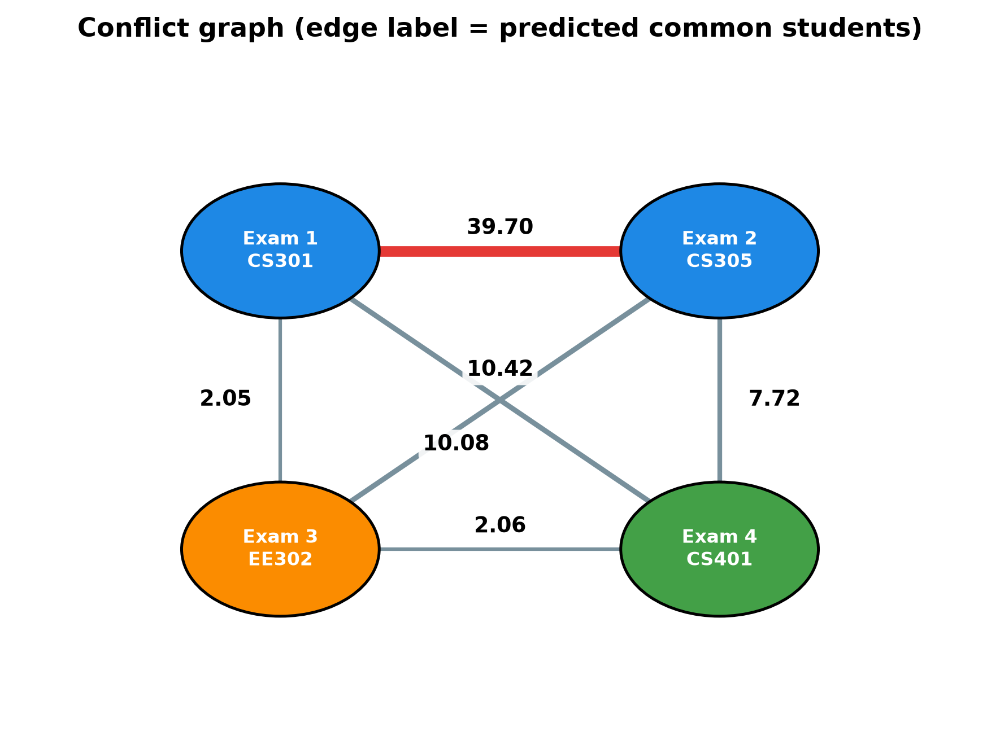
*Figure 4. Conflict graph: edge label and thickness show predicted common students.*

Summing each row of $C$ gives the per-exam conflict burden: Exam 1 = 51.83, Exam 2 = 57.84, Exam 3 = 14.53, Exam 4 = 19.86 students (Figure 5). Exams 1 and 2 are the most constrained and should be kept apart; Exam 3 is nearly free of conflicts.

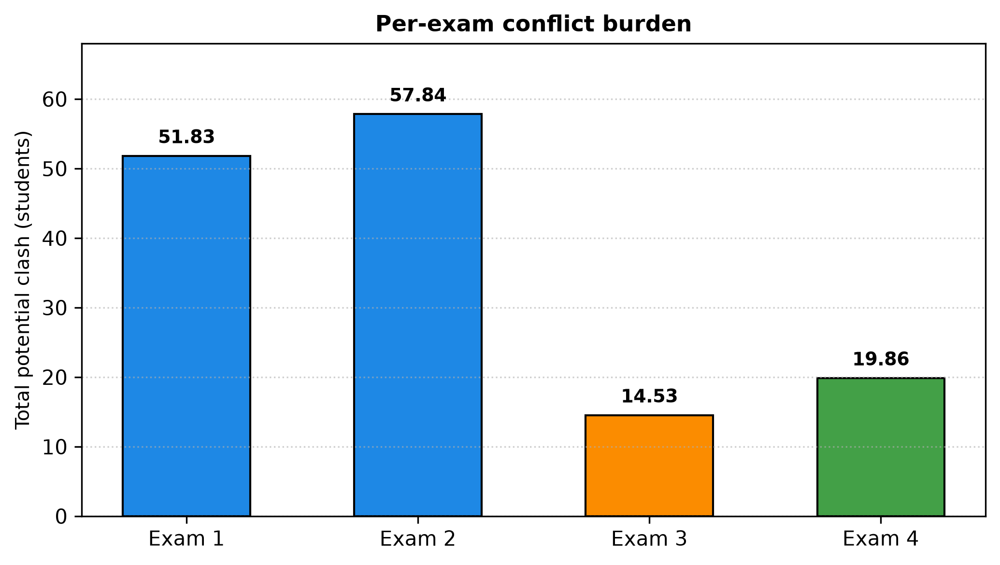
*Figure 5. Total predicted conflict burden per exam.*

---

## 6. Part (b): QUBO Formulation and Brute-Force Verification

### 6.1 Decision variables
Let $x(i, s) \in \{0, 1\}$ indicate that exam $i$ sits in slot $s$. The vector is ordered as follows, with index $k(i, s) = 2(i - 1) + (s - 1)$:
$$\mathbf{x} = [x_{11}, x_{12}, x_{21}, x_{22}, x_{31}, x_{32}, x_{41}, x_{42}]^T \in \{0, 1\}^8$$

### 6.2 Energy function
- **Objective (clash cost).** Two exams in the same slot cost their predicted clash:
  $$H_{\text{clash}}(\mathbf{x}) = \sum_s \sum_{i < j} C_{ij} \cdot x_{is} \cdot x_{js}$$
- **Rule penalty.** Each exam must satisfy $x(i, 1) + x(i, 2) = 1$. Using $x^2 = x$ for binary variables:
  $$(x_{i1} + x_{i2} - 1)^2 = -x_{i1} - x_{i2} + 2 x_{i1} x_{i2} + 1$$
  $$P_{\text{rule}}(\mathbf{x}) = \lambda \sum_i (-x_{i1} - x_{i2} + 2 x_{i1} x_{i2}) + 4\lambda$$
- **Total.** $E(\mathbf{x}) = H_{\text{clash}}(\mathbf{x}) + P_{\text{rule}}(\mathbf{x}) = \mathbf{x}^T Q \mathbf{x} + 4\lambda$, with $\lambda = 100$ and constant offset 400.

### 6.3 Building Q
- Diagonal $Q(k, k) = -\lambda = -100$ for all eight variables.
- Rule coupling $Q(x_{i1}, x_{i2}) = 2\lambda = 200$ for each exam.
- Clash coupling $Q(x_{i, s}; x_{j, s}) = C(i, j)$ for $i < j$ and each slot $s$.
- All other entries are 0.

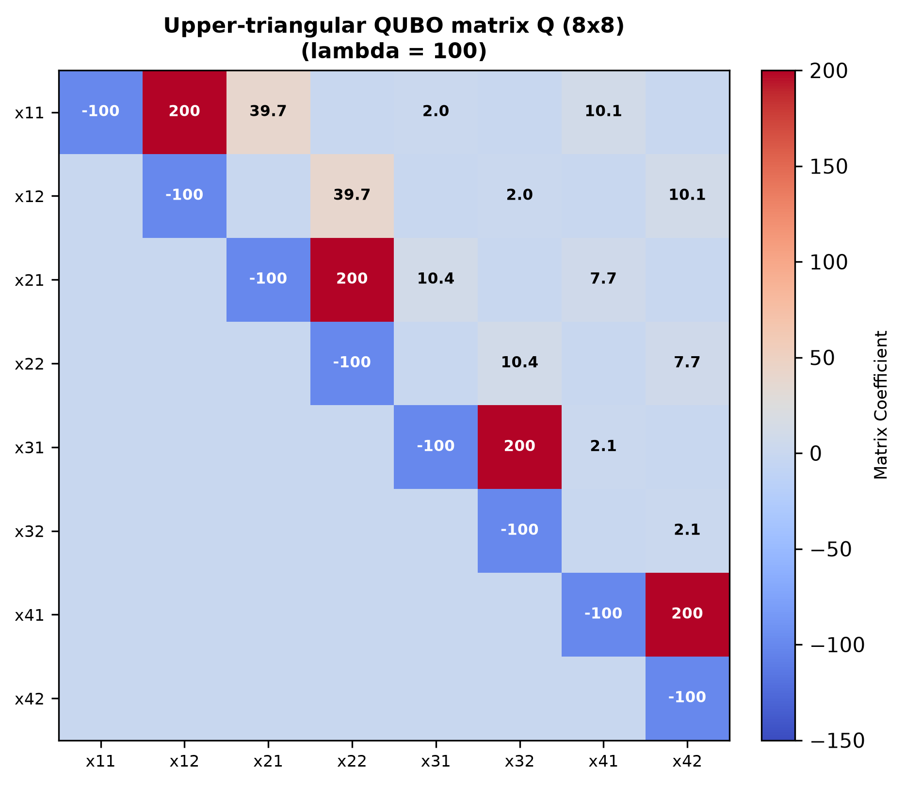
*Figure 6. Upper-triangular Q matrix built from the SVR predictions (lambda = 100).*

```python
def build_qubo_matrix(clash_matrix, lambda_penalty=100.0, ...):
    Q = np.zeros((8, 8))
    for i in range(4): # constraint linear terms
        for s in range(2): Q[2*i+s, 2*i+s] += -lambda_penalty
    for i in range(4): # constraint quadratic terms
        Q[2*i, 2*i+1] += 2.0 * lambda_penalty
    for i in range(4): # clash terms, same slot only
        for j in range(i+1, 4):
            for s in range(2): Q[2*i+s, 2*j+s] += clash_matrix[i, j]
    return Q, 4 * lambda_penalty
```

### 6.4 Brute-force check over all 256 states
Every 8-bit string was evaluated. Exactly 16 satisfy the single-slot rule; the remaining 240 pay a penalty of at least 100. Re-computing the spectrum from the repository code confirms that the cheapest invalid state costs 102.05, while even the most expensive valid schedule (all four exams in one slot, the sum of all six clashes) costs only about 71.7. The penalty barrier therefore cleanly separates valid and invalid states (Figure 7, log scale).

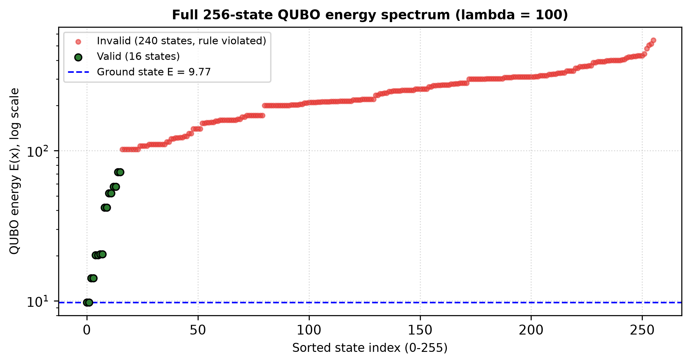
*Figure 7. Energy of all 256 states, sorted. Valid states (green) lie far below the penalised states (red).*

Within the valid set, the lowest energy is 9.77, reached by two symmetric twins that differ only by swapping the slot labels:

### Table 8. Brute-force ground states
| Bitstring | Slot 1 | Slot 2 | Clash calculation | Energy |
| :--- | :--- | :--- | :--- | :---: |
| **01100110** | {Exam 2, Exam 4} | {Exam 1, Exam 3} | $7.72 + 2.05$ | **9.77** |
| **10011001** | {Exam 1, Exam 3} | {Exam 2, Exam 4} | $2.05 + 7.72$ | **9.77** |

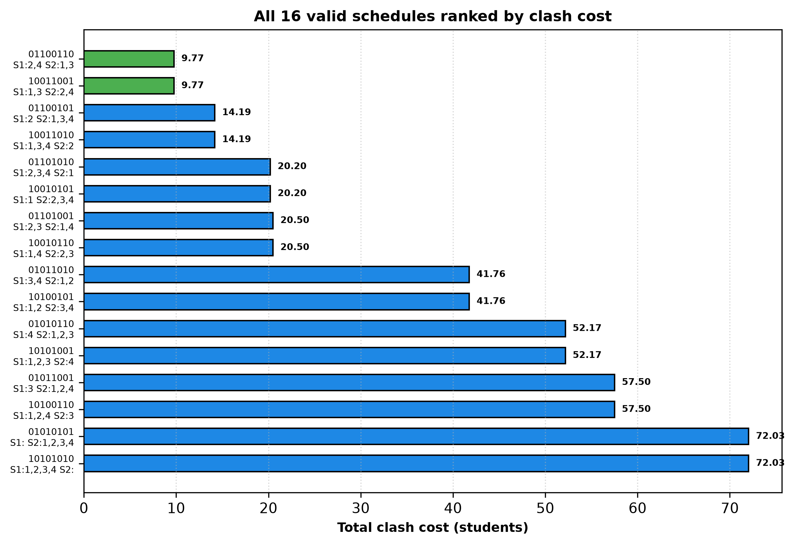
*Figure 8. All 16 valid schedules ranked by clash cost (S1 / S2 are the exams in each slot).*

**Correctness argument:** any schedule that places Exam 1 and Exam 2 together pays 39.70, which is more than every schedule that separates them. Among the four ways to split {1, 2} apart, pairing Exam 3 with Exam 1 and Exam 4 with Exam 2 minimises the residual clashes ($2.05 + 7.72$), proving that 9.77 is the global minimum.

---

## 7. Part (c): Quantum Annealing on a Simulator

### 7.1 Method
Quantum annealing evolves $H(t) = A(t) H_{\text{driver}} + B(t) H_{\text{problem}}$, starting from a uniform superposition and slowly turning on the problem Hamiltonian. The repository emulates this on a classical simulator using Metropolis simulated annealing with a geometric inverse-temperature schedule beta from 0.1 to 10 over 300 sweeps (Figure 9). For a single bit flip, the energy change is computed in $\mathcal{O}(N)$:
$$\Delta E_k = \Delta x_k (2 (Q_{\text{sym}} \mathbf{x})_k + Q_{kk} \Delta x_k), \quad \text{accept with probability } \min(1, \exp(-\beta \Delta E_k))$$

The module also contains a path-integral (Trotter-slice) simulated quantum annealing routine, but the reported results use the plain simulated-annealing sampler (`method = "simulated_annealing"` in `metrics_summary.json`). The result is therefore a classical simulation of annealing, not a run on quantum hardware.

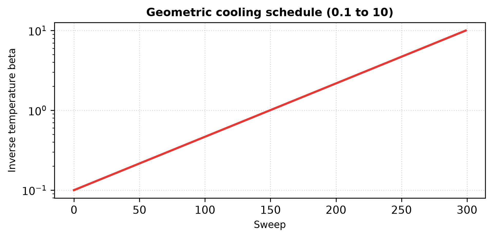
*Figure 9. Geometric inverse-temperature schedule used in each read.*

### 7.2 Results (1000 reads, seed 12)
### Table 9. Annealing results
| Quantity | Value |
| :--- | :--- |
| **Best answer** | `01100110` (Slot 1 = {Exam 2, Exam 4}, Slot 2 = {Exam 1, Exam 3}) |
| **Best energy** | **9.77** |
| **Appearance of best state** | 82 / 1000 reads (8.2%) |
| **Symmetric twin 10011001** | 66 / 1000 reads (6.6%) |
| **Combined ground-state frequency** | **148 / 1000 reads (14.8%)** |
| **Gap to brute-force optimum** | **0.0000** |

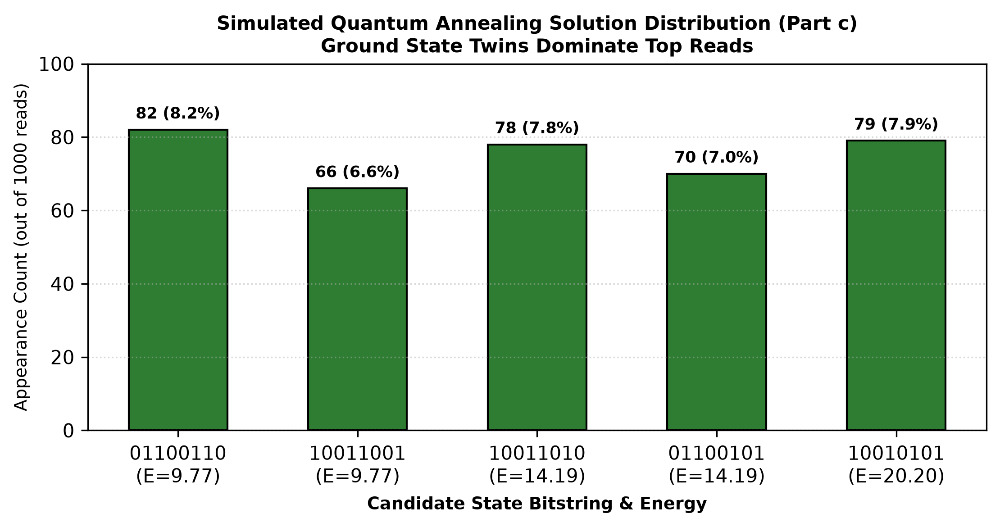
*Figure 10. Five most frequent states in 1000 reads, with energies. The two ground states are 01100110 and 10011001.*

Reading the histogram honestly: the two ground states are the most energetically favourable, but they account for only about 15% of reads. States with $E = 14.19$ and $E = 20.20$ appear almost as often (7.0–7.9% each). This indicates the annealer is not strongly concentrated on the optimum under this schedule: it finds the optimum reliably when many reads are taken, but a single read is far from guaranteed to succeed. A slower schedule or more sweeps would raise the ground-state fraction, and this is exactly what motivates the multi-restart strategy in Part (d).

### 7.3 Comparison with brute force
### Table 10. Annealer vs exhaustive search
| Metric | Brute force | Annealer | Match |
| :--- | :--- | :--- | :--- |
| **Ground energy** | 9.77 | 9.77 | Yes (gap 0.0000) |
| **Optimal state(s)** | 01100110, 10011001 | 01100110 (twin also observed) | Yes |
| **Constraint validity** | Valid | Valid | Yes |
| **Cost** | 256 evaluations | 1000 reads $\times$ 300 sweeps $\times$ 8 flips | Brute force cheaper at this size |

For only 8 variables, exhaustive search is trivially cheaper than annealing. The annealer's value is that its cost grows gently with problem size, whereas brute force grows as $2^n$; its agreement with the exact answer here validates the QUBO and the sampler.

---

## 8. Part (d): Parallel Computing with multiprocessing.Pool
Because annealing is stochastic, several independent restarts with different seeds raise the chance of hitting the ground state. Restarts are independent, so the workload is embarrassingly parallel. The benchmark runs 16 restarts (seeds $100 + 37k$, each with 40 reads of 200 sweeps) through `Pool(processes = p).map` for $p = 1, 2 \text{ and } 4$, timing each run with `time.perf_counter()`:
$$S_p = \frac{T_1}{T_p}, \qquad E_p = \frac{S_p}{p} = \frac{T_1}{p \cdot T_p}$$

```python
seeds = [100 + i * 37 for i in range(16)]
tasks = [(s, Q, offset, 40, 200) for s in seeds]
for workers in [1, 2, 4]:
    t0 = time.perf_counter()
    with mp.Pool(processes=workers) as pool:
        results = pool.map(_annealing_restart_worker, tasks)
    timings[workers] = time.perf_counter() - t0
```

### Table 11. Parallel scaling benchmark (16 restarts)
| Workers $p$ | Time $T_p$ (s) | Speed-up $S_p$ | Efficiency $E_p$ |
| :---: | :---: | :---: | :---: |
| **1** | 19.8898 | 1.00x (baseline) | 100.0% |
| **2** | 14.2796 | 1.39x | 69.6% |
| **4** | 13.5851 | 1.46x | 36.6% |

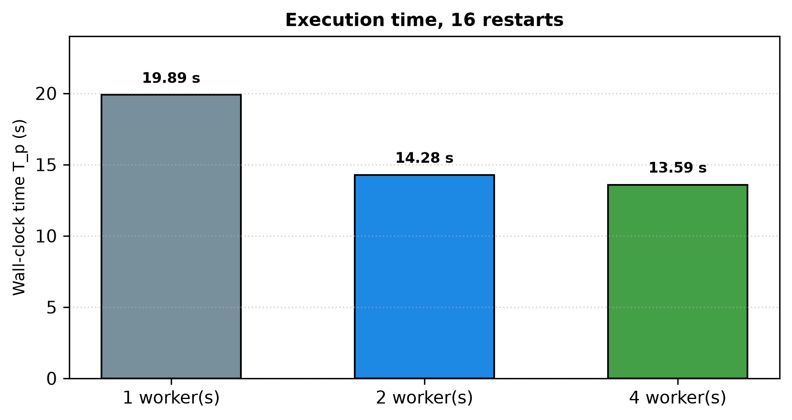
*Figure 11. Wall-clock time for 16 restarts.*

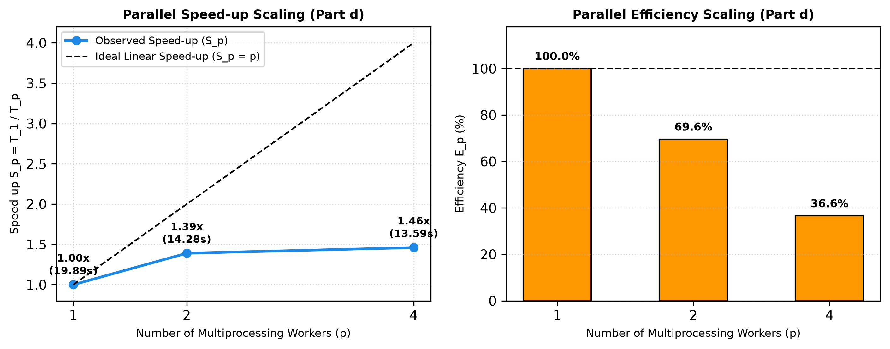
*Figure 12. Observed speed-up against the ideal line, and parallel efficiency.*

Every worker configuration found the same minimum energy, 9.77, so correctness was not affected by parallelisation. Scaling, however, is clearly sub-linear: going from 2 to 4 workers only improves the time from 14.28 s to 13.59 s. According to Amdahl's law, $S(p) = \frac{1}{(1 - f) + f/p}$ where $f$ is the parallel fraction; the observed speed-up of $1.46\times$ at $p = 4$ implies $f$ of about 0.42, meaning a large part of the elapsed time does not parallelise. The repository attributes this to process start-up under Windows' spawn model, pickling of the arguments and results, and shared cache and memory contention. The benchmark was also taken on a single run, so the timings carry some noise; repeating the measurement several times and reporting the mean would make the numbers more robust. It is also not stated how many physical cores the test machine had, which limits how far the 4-worker result can be interpreted.

---

## 9. Part (e): Conclusion in Three Lines
1. **Final choice:** Slot 1 = {Exam 2, Exam 4} and Slot 2 = {Exam 1, Exam 3}, giving the global-minimum predicted clash of 9.77 students.
2. **ML and quantum learning:** SVR-predicted clash counts map directly into an 8-variable QUBO, where the quadratic penalty enforces the one-slot rule exactly, and annealing reproduces the brute-force global minimum.
3. **Parallel computing learning:** Independent restarts parallelise naturally through `multiprocessing.Pool` and gave a 1.46x speed-up on 4 workers (36.6% efficiency), showing that process overhead limits gains on such small tasks.

---

## 10. Verification and Testing
The repository ships a unittest suite (11 tests) that covers each stage:
- **Data generation:** 600 rows, valid bounds and feature columns.
- **SVR:** test $R^2$ above 0.85 and RMSE below 6.0; the $4 \times 4$ clash matrix is symmetric with a zero diagonal.
- **QUBO:** shape (8, 8), penalty off-diagonals, bitstring decoding, 256 states evaluated and 16 valid schedules.
- **Annealing:** convergence to the brute-force global minimum.
- **Parallel runner:** workers execute and the speed-up is positive.

As an independent check for this report, the data generation, SVR training, Q construction and 256-state enumeration were re-run from the repository code. They reproduced the test RMSE (3.4376), test $R^2$ (0.9326), the clash matrix, the 16 valid states and the ground energy of 9.77 exactly.

---

## 11. Discussion and Limitations
- **Synthetic data.** The SVR is trained on data produced by the very overlap rules it is meant to learn, so the high $R^2$ shows the model learns those rules, not that it will predict real enrolments equally well.
- **Simulated, not quantum.** The annealer is a classical Metropolis sampler; no quantum hardware or Hamiltonian-level simulation was used for the reported results.
- **Tiny instance.** With 256 states, brute force is faster and exact. The method's value appears for larger timetables with many exams and slots.
- **Penalty choice.** $\lambda = 100$ works here, but an overly large lambda on larger problems compresses the useful energy scale and can make annealing harder.
- **Parallel benchmark.** Single-run timings on one machine; efficiency depends on the core count and spawn overhead.
- **Minor inconsistencies in the repository.** The repository's original text quoted training RMSE 2.8941 and $R^2$ 0.9512, whereas re-running the code gives 2.2593 and 0.9695 (test metrics match). The saved `qubo_energy_spectrum.png` originally showed only the first 10 sorted states and no invalid ones, so Figure 7 here was regenerated from the same code. Neither affects the main results.

---

## 12. Conclusion
The study shows how machine learning, QUBO modelling, annealing and parallel computing can be chained into one workable scheduling pipeline. The SVR supplied clash estimates with $R^2 = 0.93$; the QUBO encoded both objective and rule in a single 8x8 matrix; brute force proved the optimum (9.77 students, Exam 2 and 4 together, Exam 1 and 3 together); the annealer agreed with it; and parallel restarts cut the run time by up to 1.46x. Scaling the idea to realistic timetables would need real enrolment data, larger instances and a proper quantum or hybrid solver.

---

## References and Reproduction
- **Repository:** `github.com/siyam-bubere/OT-LABEXAM-Q4` (all code, tests, figures and `metrics_summary.json`).
- **Run everything:** `pip install -r requirements.txt`, then `python run_pipeline.py`.
- **Run tests:** `python -m unittest discover tests`.
- Smola, A. J. and Scholkopf, B. (2004). *A tutorial on support vector regression.* Statistics and Computing, 14(3).
- Lucas, A. (2014). *Ising formulations of many NP problems.* Frontiers in Physics, 2, 5.
- Kirkpatrick, S., Gelatt, C. D. and Vecchi, M. P. (1983). *Optimization by simulated annealing.* Science, 220.
